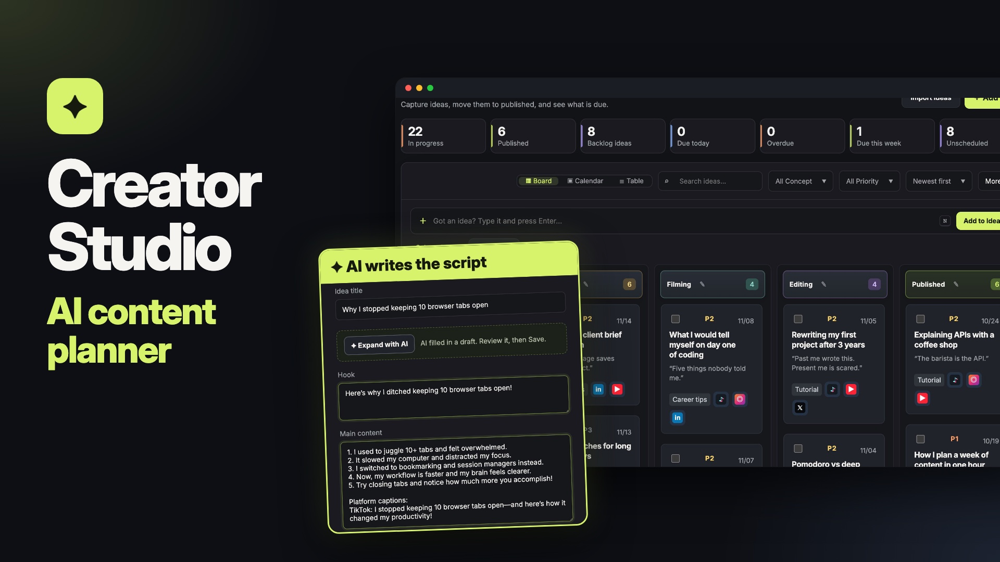

# Content Creator Studio



A web workspace for short-form video creators that replaces a content spreadsheet: a production
pipeline for ideas, an audio library, a quick-reference library of production rules, and an AI
brainstorm that drafts a version of each idea for every platform you post to.

React + Vite frontend, FastAPI backend, Supabase (PostgreSQL + Auth) for data, deployed as a single
Render web service.

## Features

- **Pipeline**: Board, Calendar and Table views of the same ideas. Ideas move through five
  stages (idea → script → filming → editing → published) by drag and drop, with concept,
  priority, publish date, hook and the platforms each idea targets. Columns can be renamed,
  reordered and extended per workspace.
- **Quick capture**: press `N` anywhere on the board, type a title and hit Enter; the card shows up
  in the first column at once and saves in the background.
- **Expand with AI**: on any idea card, AI writes a hook, numbered beats and one caption per
  platform into the form for you to review before saving.
- **Multi-platform**: each idea can target TikTok, Instagram Reels, YouTube Shorts, Facebook Reels,
  LinkedIn and X, with a publish date and link per platform.
- **AI brainstorm**: describe a topic, pick format, length and platforms; the backend calls an
  OpenAI-compatible Responses API and returns structured ideas with per-platform adaptations.
  Choose the column and concept, then save one or all three ideas to the board and open them
  there. Brainstorm history is saved. The browser never sees the API key.
- **Audio library and quick reference**: background tracks, editing shortcuts, export presets and
  filming SOPs in one place.
- **JSON import**: upload or paste JSON, preview counts and sample rows, then import (1 MB / 500
  rows per request, validated server-side).
- **Workspaces**: Supabase Auth, workspaces with `owner` / `admin` / `editor` / `viewer` roles and
  row-level security. A simpler single-password mode exists for local prototypes.
- **Light and dark themes**, following the system setting until you pick one.
- **Phone layout**: a bottom tab bar instead of the sidebar, swipeable Kanban columns and a column
  picker on cards for touch screens.
- **8 UI languages**: Vietnamese, English, Korean, Japanese, Indonesian, Thai, Malay, Filipino.

## Run locally

Requires Node.js 20+ and Python 3.11+.

```bash
cp .env.example .env            # fill in what you need; see below
python3 -m venv .venv && . .venv/bin/activate
pip install -r backend/requirements.txt
npm --prefix frontend install
npm --prefix frontend run build
set -a; . ./.env; set +a
uvicorn backend.app.main:app --reload --port 4173
```

Open http://localhost:4173. For frontend hot reload, run `npm --prefix frontend run dev` and proxy
`/api` to the FastAPI port.

The web app signs in with Supabase Auth, so set up a Supabase project (see Database) before
running it. Without Supabase the backend falls back to an in-memory store loaded from
`sheet-data.json` (sample data) with a password session (`AUTH_MODE=legacy`, `APP_PASSWORD`,
`APP_SESSION_SECRET`); that path is used by the API tests, and the UI does not support it yet.

## Configuration

| Variable | Used by | Purpose |
|---|---|---|
| `SUPABASE_URL`, `SUPABASE_PUBLISHABLE_KEY` | backend | Supabase project and public key |
| `SUPABASE_SECRET_KEY` | backend only | service-role access; never expose to the browser |
| `VITE_SUPABASE_URL`, `VITE_SUPABASE_PUBLISHABLE_KEY` | frontend build | Supabase Auth in the browser |
| `ADMIN_USER_IDS` | backend | comma-separated Supabase user IDs with admin access |
| `LLM_API_KEY` | backend only | key for the AI brainstorm |
| `LLM_BASE_URL` | backend | any OpenAI-compatible endpoint (default `https://api.openai.com/v1`) |
| `LLM_MODEL` | backend | model name (default `gpt-4.1-mini`) |

## Database

1. Create a Supabase project.
2. Apply the schema: paste `supabase/setup.sql` into the SQL Editor and run it once, or run
   `supabase db push` with the migrations in `supabase/migrations/`. `setup.sql` is all migrations
   in order; rebuild it with `supabase/build_setup.sh` after adding one.
3. Sign up in the app, then optionally load the demo workspace (see Demo workspace).

Rollback scripts live in `supabase/rollback/` and are applied manually. Never change what a migration that
has already run does; add a new one.

### Demo workspace

`supabase/demo_seed.sql` creates an English workspace called "Rio Studio" (`WORKSPACE_NAME` in the generator) with 28 ideas
across all five pipeline columns, 12 audio tracks, platform presets, shortcuts, SOPs, concepts and
two brainstorm results. Dates are relative to the day you run it. Sign up once in the app, put that
email in the `demo_email` line, and run the file in the SQL editor. All rows belong to the new
workspace, so it does not touch other workspaces. Edit the content in `supabase/demo_seed.py` and
regenerate with `python3 supabase/demo_seed.py`.

## Deploy

`render.yaml` defines one Render web service: it builds the React app into `frontend/dist`, and
FastAPI serves those files and `/api/*` from the same origin. Set the variables above in the Render
dashboard.

## Tests

```bash
python3 -m unittest discover -s backend/tests
node --test tests/*.test.mjs
```

## Project layout

- `frontend/`: React + Vite client
- `backend/app/`: FastAPI routes, validation, Supabase repository, in-memory fallback, AI proxy
- `supabase/`: schema, migrations, rollbacks, seed and import SQL
- `tests/`, `backend/tests/`: frontend data and backend behavior tests
- `SPEC.md`, `PAIN_POINTS.md`: product spec and backlog notes
